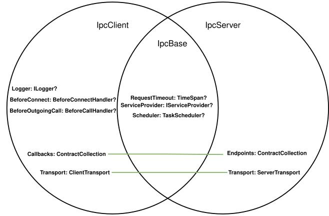

# UiPath.Ipc

[](https://uipath.visualstudio.com/CoreIpc/_build?definitionId=637)
[](https://uipath.visualstudio.com/Public.Feeds/_artifacts/feed/UiPath-Internal/NuGet/UiPath.Ipc/overview/2.5.1-20250714-01)
[](https://github.com/UiPath/coreipc/pkgs/npm/coreipc)
[](https://github.com/UiPath/coreipc/pkgs/npm/coreipc-web)
[](https://opensource.org/licenses/MIT)


> **Lightweight RPC framework** enabling bidirectional communication with interface-based contracts over **Named Pipes, TCP/IP, and WebSockets**. Supports .NET servers/clients and [Node.js/Web clients](src/Clients/js).

## 🚀 Features

- **🔄 Asynchronous**: Fully async/await compatible API
- **🔥 One-way Calls**: Fire-and-forget methods (methods returning non-generic `Task`)
- **📞 Callbacks**: Bidirectional communication with callback interfaces
- **⚡ Task Scheduling**: Configurable task scheduler support
- **📡 Multiple Transports**: Named Pipes, TCP/IP, WebSockets or custom transport
- **🔒 Security**: Client authentication and impersonation for Named Pipes
- **📦 JSON Serialization**: Built-in JSON serialization with Newtonsoft.Json
- **🏗️ DI Support**: Integration with Microsoft.Extensions.DependencyInjection
- **⏰ Cancellation & Timeouts**: Comprehensive cancellation token and timeout support
- **🔄 Auto-reconnect**: Broken connections are re-established transparently; you keep using the same proxy instance.
- **🛡️ Interception**: BeforeConnect, BeforeIncommingCall and BeforeOutgoingCall interception capabilities
- **📊 Stream Access**: Direct access to underlying transport streams
- **🌐 Cross-platform**: .NET 8, .NET Framework 4.7.2, and .NET 8 Windows support

## 📦 Installation

```bash
dotnet add package UiPath.Ipc
```

## 🏃‍♂️ Quick Start

### 1. Define Your Service Contract

```csharp
public interface IComputingService
{
    Task<float> AddFloats(float x, float y, Message m = null!, CancellationToken ct = default);
    Task<bool> Wait(TimeSpan duration, CancellationToken ct = default);
}

public interface IComputingCallback
{
    Task<string> GetThreadName();
}
```

### 2. Implement Your Service

```csharp
public sealed class ComputingService : IComputingService
{
    public async Task<float> AddFloats(float a, float b, Message m = null!, CancellationToken ct = default)
    {
        return a + b;
    }

    public async Task<bool> Wait(TimeSpan duration, CancellationToken ct = default)
    {
        await Task.Delay(duration, ct);
        return true;
    }
}
```

### 3. Create and Start the Server

> Creating a server is done by instantiating the `IpcServer` class, setting its properties and calling the `Start` method.

```csharp
await using var serviceProvider = new ServiceCollection()
    .AddScoped<IComputingService, ComputingService>()
    .BuildServiceProvider();

await using var server = new IpcServer
{
    Transport = new NamedPipeServerTransport { PipeName = "computing" },
    ServiceProvider = serviceProvider,
    Endpoints = new() { typeof(IComputingService) }
};
server.Start();
```

### 3. Create the Client

> Creating a client is done by 1st implementing all the callback interfaces you'll want to expose as a client:

```csharp
public sealed class ComputingCallback : IComputingCallback
{
    public Task<string> GetThreadName() => Task.FromResult(Thread.CurrentThread.Name);
}
```

and then instantiating the `IpcClient`, setting its properties, obtaining a proxy via the `GetProxy<T>` method and using that proxy.

```csharp
await using var serviceProvider = new ServiceCollection()
    .AddScoped<IComputingCallback, ComputingCallback>()
    .BuildServiceProvider();

var client = new IpcClient
{
    Transport = new NamedPipeClientTransport { PipeName = "computing" },
    ServiceProvider = serviceProvider,
    Callbacks = new() { typeof(IComputingCallback) }
}

var computingService = client.GetProxy<IComputingService>();
var three = await computingService.AddFloats(1, 2);
```

## 🔧 Advanced Features

### Callbacks and Bidirectional Communication

```csharp
public class ComputingCallback : IComputingCallback
{
    public async Task<string> GetThreadName()
    {
        return Thread.CurrentThread.Name ?? "Unknown";
    }

    public async Task<int> AddInts(int x, int y)
    {
        return x + y;
    }
}

// Server can call back to client
public async Task<string> GetCallbackThreadName(TimeSpan waitOnServer, Message message, CancellationToken cancellationToken)
{
    await Task.Delay(waitOnServer, cancellationToken);
    return await message.Client.GetCallback<IComputingCallback>().GetThreadName();
}
```

### Dependency Injection Integration

```csharp
var services = new ServiceCollection()
    .AddLogging(builder => builder.AddConsole())
    .AddSingleton<IComputingService, ComputingService>()
    .AddSingleton<ISystemService, SystemService>()
    .BuildServiceProvider();

var ipcServer = new IpcServer
{
    ServiceProvider = services,
    // ... other configuration
};
```

### Custom Task Scheduling

```csharp
var ipcServer = new IpcServer
{
    Scheduler = new ConcurrentExclusiveSchedulerPair().ExclusiveScheduler,
    // ... other configuration
};
```

### Log Level of a Failed Call

The server logs a failed call as an error. A service method that expects a failure can lower the level before it throws; the caller still receives the error.

```csharp
public async Task<string> GetResourceUrl(string name)
{
    if (!HasUserSession)
    {
        IpcContext.Current!.FailedCallLogLevel = LogLevel.Debug; // LogLevel.None logs nothing
        throw new InvalidOperationException("No user session.");
    }
    // ...
}
```

The level covers only what the service method throws. If the call is cancelled or times out and the method returns anyway (it ignores its `CancellationToken`, or has already finished its work), the failure comes from the server after the method and is logged as an error whatever level was set.
### Trace context (telemetry)

Set `TelemetryPropagation` on an `IpcClient` / `IpcServer` to carry the W3C `traceparent`, `tracestate` and `baggage` across its calls and callbacks (wire-compatible with the JS and Python clients). It is a `[Flags]` `TelemetryPropagationPolicy`: `Outgoing` covers the calls and callbacks the endpoint makes, `Incoming` the ones it receives, `Both` is both. `None` by default: nothing is sent or read.

```csharp
var client = new IpcClient
{
    Transport = new NamedPipeClientTransport { PipeName = "my-pipe" },
    TelemetryPropagation = TelemetryPropagationPolicy.Both,
};
```

- **Outgoing**: to send a trace context, start an `Activity`. When `Activity.Current` has W3C ids, each call starts a client span `<Endpoint>/<MethodName>` (`ActivityKind.Client`, a child of `Activity.Current`, from connecting until the call returns) and sends its `traceparent`, `tracestate` and `baggage`. `BeforeOutgoingCall` runs under that span, so what it adds to `Activity.Current` is sent too. Otherwise nothing is sent and no span is started: to send nothing for a call, make it with `Activity.Current = null`. To continue a trace from elsewhere, give the `Activity` that `traceparent` with `SetParentId`, as below.
- **Incoming**: the handler runs under an `Activity` named `<Endpoint>/<MethodName>`, whose parent is the received `traceparent` and which has the received `tracestate` and `baggage`. The handler reads them from `Activity.Current` (`TraceStateString`, `GetBaggageItem`), and nested calls continue the trace. A call with neither a valid `traceparent` nor any `baggage` runs with no `Activity`. Without `Incoming`, handlers run with no `Activity.Current`, so the spans they start are new traces.
  - A call with a `baggage` but no `traceparent` runs under a new root `Activity` (a new trace id) that carries the baggage, as ASP.NET Core does. JS on Node with an OpenTelemetry context manager registered (as `NodeSDK.start()` does), and Python with `opentelemetry-api` installed, start no spans but pass it on alone; otherwise, and in the browser, it goes no further unless the handler forwards it.
  - Incoming trusts the caller: it picks the trace id, the sampled flag and the baggage your handler runs under and passes on. Turn it on only for peers you trust.
- **Rules**: the same on .NET, JS and Python. .NET writes and reads the headers through DiagnosticSource's W3C propagator (`DistributedContextPropagator.CreateW3CPropagator()`, never `Current`), and JS and Python write and read the same bytes.
  - Only the exact lowercase names `traceparent`, `tracestate` and `baggage` are read. Other spellings, and `Correlation-Context`, are ignored.
  - A `traceparent` must follow W3C Trace Context §3.2. A received one that doesn't is ignored, and so is its `tracestate`. A higher version is read by its first 55 characters and passed on as version `00`.
  - A `tracestate` travels only with a `traceparent`. It is cut before its first member that breaks the grammar (a value can't hold a space), and to the whole members that fit in 256 characters. There is no member limit.
  - A `baggage` is sent as `key = value` members joined by `, `. A key must be a token and is sent as is; a member whose key isn't one is skipped. A value is percent-encoded as UTF-8, except visible ASCII other than `"`, `%`, `,`, `;` and `\`; a null value is sent empty, and a lone surrogate as U+FFFD. At most 64 members are sent, and sending stops at the first member that, with its `, `, would take the header to 8192 characters or more.
  - A received `baggage` is read up to a member with no `=`, or with `=` first or last (`k=`): that member and the rest are dropped. A member whose key isn't a token, or whose value has a raw non-ASCII character or a broken `%` escape, is skipped. Keys aren't decoded. Values are trimmed and decoded, `;` properties included, and an escape that isn't valid UTF-8 decodes to U+FFFD (JS and Python use their own UTF-8 decoders, so a broken sequence can give a different number of U+FFFD than on .NET). There are no limits on receive, and of a repeated key the first one wins.
  - .NET sends `Activity.Baggage`: newest first, so a key set on both a parent and a child goes twice, the child's first. It sends nothing without a W3C `Activity.Current`, so never a `baggage` alone.
- A failed call sets `ActivityStatusCode.Error` on the client and server spans.
- On .NET Framework the default `Activity` id format is hierarchical, and a call under a hierarchical `Activity.Current` sends nothing. Set `Activity.DefaultIdFormat = ActivityIdFormat.W3C; Activity.ForceDefaultIdFormat = true;` at startup (the OpenTelemetry SDK does this), or give the `Activity` a W3C parent with `SetParentId`, as below.
- UiPath.Ipc references `System.Diagnostics.DiagnosticSource` 10.0.10 on every target. On .NET Framework its assembly version is 10.0.0.10, so a host that ships another version needs a binding redirect to 10.0.0.10.
  - This changes the whole process: from DiagnosticSource 10 the default `DistributedContextPropagator.Current` is W3C (before, it was the legacy one), so on .NET 8 and 9 the host's `HttpClient` sends `baggage` instead of `Correlation-Context`, even with `TelemetryPropagation` at `None`. (On .NET Framework `HttpClient` writes `Correlation-Context` whatever the default is, and on .NET 10 the default is W3C already.) To go back, set `DistributedContextPropagator.Current = DistributedContextPropagator.CreatePreW3CPropagator();` at startup.
- Subscribe to the `UiPath.Ipc` `ActivitySource` (OpenTelemetry: `.AddSource("UiPath.Ipc")`) in both the calling and the serving process. Otherwise the client and server spans are plain, unexported `Activity`s, and the spans under them point to a parent the backend never receives (as with `HttpClient`).
- The ambient `baggage` is the `Activity`'s: a call sends `Activity.Current`'s, and the handler's `Activity` gets the received one. CoreIpc doesn't read or set OpenTelemetry's `Baggage`, which keeps its own.

```csharp
// The caller
using (var activity = new Activity("AddFloats").SetParentId("00-4bf92f3577b34da6a3ce929d0e0e4736-00f067aa0ba902b7-01").Start())
{
    activity.AddBaggage("userId", "alice");
    await proxy.AddFloats(1.5f, 2.5f);
}

// The handler
var userId = Activity.Current?.GetBaggageItem("userId"); // "alice"
```

## 🧩 Notable Types

### 1. The `IpcServer`, `IpcClient` and `IpcBase` classes.

> This hierarchy is used for creating and hosting servers and clients respectively.

> ```csharp
> public abstract class IpcBase { ... }
> public sealed class IpcServer : IpcBase { ... }
> public sealed class IpcClient : IpcBase { ... }
> ```



#### i. `IpcBase`

> This class defines the settings shared between servers and clients.

| Property | Type | Notes |
| -------- | ---- | ----- |
| ServiceProvider | IServiceProvider? | **Optional**, defaults to **null**: Resolves services when handling incomming calls. |
| Scheduler | TaskScheduler? |  **Optional**, defaults to the thread pool: Schedules incomming calls. |
| RequestTimeout | TimeSpan? | **Optional**, defaults to infinity: Interval after which the honoring of requests will time out. |
| PropagatedExceptionDataKeys | `IReadOnlyCollection<string>?` | **Optional**, defaults to `["UiPath.ErrorInfo.Error"]`: The `Exception.Data` keys whose string values are sent with the errors of the calls it handles, landing in the caller's `RemoteException.Data`. Assigning replaces the list, so list `UiPath.ErrorInfo.Error` too to keep it. `null` or empty sends none of its own; entries received from a further call still travel on. |
| TelemetryPropagation | TelemetryPropagationPolicy | **Optional**, defaults to **None**: Directions (`Incoming`, `Outgoing`, `Both`) in which W3C trace context is propagated, see [Trace context](#trace-context-telemetry). |


#### ii. `IpcServer`

**Declared properties**

| Property | Type | Notes |
| -------- | ---- | ----- |
| Endpoints | ContractCollection  | **Required**: The collection of `ContractSettings`, which specifies the services to be exposed over Ipc. |
| Transport | ServerTransport |  **Required**: The server's transport, meaning whether it accepts connection over Named Pipes, TCP/IP, WebSockets, or a custom communication mechanism. |

**Methods**

| Method | Description |
| ------ | ----------- |
| `void Start()` | This method starts hosting the current `IpcServer` instance, meaning that it's imminent the transport will start listening and accepting connections, and those connections' calls will start to be honored. <br /> <br /> It's thread-safe and idempotent. It returns once the transport can take connections: a named pipe exists by then, so a client started right after `Start` returns can connect, and the operating system queues that connection until the server accepts it. Further changes to the otherwise mutable `IpcServer` instance  have no effect on the listener's settings or its exposed service collection. <br /> <br /> Exceptions: <br />- `InvalidOperationException`: wrong configurations, such a `null` or invalid transport.<br />- `ObjectDisposedException`: the `IpcServer` instance had been disposed.<br />- Whatever the transport throws while creating its first listening endpoints, for example an `UnauthorizedAccessException` when a named pipe's access control is refused. Whatever was already created is disposed first. |
| `ValueTask DisposeAsync()` | Stops the connection accepter and cancels all active connections before completing the returned `ValueTask`. |

<hr />

#### iii. `IpcClient`

**Declared properties*

| Property | Type | Notes |
| -------- | ---- | ----- |
| Callbacks | ContractCollection  | **Optional**: The collection of `ContractSettings`, which specifies the services to be exposed over Ipc **as callbacks**. |
| Transport | ClientTransport |  **Required**: The client's transport, meaning whether it connects to the server over Named Pipes, TCP/IP, WebSockets, or a custom communication mechanism. |

**Methods**

| Method | Notes |
| ------ | ----- |
| `TProxy GetProxy<TProxy>() where TProxy : class` | Returns an Ipc proxy of the specified type, which is the gateway for remote calling. This method is idempotent, meaning that it will cache its result. |

### 2. The `ContractCollection` and `ContractSettings` classes.

#### i. `ContractCollection`

> `ContractCollection` is a type-safe collection that holds `ContractSettings` instances, mapping service interface types to their configuration. It implements `IEnumerable<ContractSettings>` and provides convenient `Add` methods for different scenarios.

**Add Methods:**

| Method | Description |
| ------ | ----------- |
| `Add(Type contractType)` | Adds a contract type that will be resolved from the service provider when needed (deferred resolution). |
| `Add(Type contractType, object? instance)` | Adds a contract type with a specific service instance. If `instance` is `null`, uses deferred resolution. |
| `Add(ContractSettings endpointSettings)` | Adds a pre-configured `ContractSettings` instance directly. |

#### ii. `ContractSettings`

> `ContractSettings` represents the configuration for a single service contract, including how the service instance is created/resolved, task scheduling, and call interception.

**Properties:**

| Property | Type | Description |
| -------- | ---- | ----------- |
| `Scheduler` | `TaskScheduler?` | **Optional**: Custom task scheduler for this specific contract. Inherits from `IpcBase.Scheduler` if not set. |
| `BeforeIncomingCall` | `BeforeCallHandler?` | **Optional**: Interceptor called before each incoming method call on this contract. |

**Constructors:**

| Constructor | Description |
| ----------- | ----------- |
| `ContractSettings(Type contractType, object? serviceInstance = null)` | Creates settings for a contract type with optional direct service instance. If `serviceInstance` is `null`, uses deferred resolution. |
| `ContractSettings(Type contractType, IServiceProvider serviceProvider)` | Creates settings for a contract type with explicit service provider for dependency injection. |

**Service Resolution Strategies:**

- **Direct Instance**: When you provide a service instance, that exact instance is used for all calls
- **Deferred Resolution**: When no instance is provided, the service is resolved from the `IpcServer`'s `ServiceProvider` when needed
- **Injected Resolution**: When you provide a specific `IServiceProvider`, services are resolved from that provider

**Usage Examples:**

```csharp
// Direct instance
var settings1 = new ContractSettings(typeof(IComputingService), new ComputingService());

// Deferred resolution (will use IpcServer.ServiceProvider)
var settings2 = new ContractSettings(typeof(IComputingService));

// Custom service provider
var customProvider = new ServiceCollection()
    .AddTransient<IComputingService, ComputingService>()
    .BuildServiceProvider();
var settings3 = new ContractSettings(typeof(IComputingService), customProvider);

// With advanced configuration
var settings4 = new ContractSettings(typeof(IComputingService))
{
    Scheduler = new ConcurrentExclusiveSchedulerPair().ExclusiveScheduler,
    BeforeIncomingCall = async (callInfo, ct) =>
    {
        Console.WriteLine($"Calling {callInfo.Method.Name}");
    }
};
```

## ⚠️ Limitations & cross-client interop

By-design boundaries and cross-client behaviour differences — value-type fidelity (incl. the `decimal`/`Int64` precision caveats; note **TypeScript has no `decimal` or 64-bit integer type**), cancellation propagation, the transport / feature / message-size matrix, and argument rules — are documented in **[LIMITATIONS.md](LIMITATIONS.md)** for mixing the .NET, Python, and TypeScript clients.
