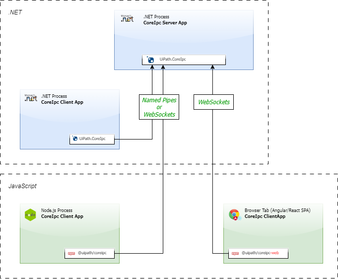

[](https://uipath.visualstudio.com/CoreIpc/_build/latest?definitionId=637&branchName=master)
[](https://github.com/UiPath/coreipc/packages/71523)

# UiPath CoreIpc client for JavaScript

## Introduction

The **UiPath CoreIpc client for JavaScript** API is complementary to the **[UiPath CoreIpc for .NET](https://github.com/UiPath/coreipc#readme)** API. It facilitates Node.js and Web apps to interop with .NET servers via RPC.

The JavaScript API is provided as two NPM packages:

| NPM Package | Target | Transports |
| - | - | - |
| [ `@uipath/coreipc`](https://github.com/UiPath/coreipc/packages/71523)     | Node.js (includes Electron) | Named Pipes, Web Sockets |
| [ `@uipath/coreipc-web`](https://github.com/UiPath/coreipc/packages/71523) | Web (Angular, React)        | Web Sockets              |

 |

## Getting started

- To install the packages, configure your `.npmrc` as described in [GitHub's documentation](https://docs.github.com/en/free-pro-team@latest/packages/using-github-packages-with-your-projects-ecosystem/configuring-npm-for-use-with-github-packages).

    > Your `.npmrc` should be similar to:
    >
    > ```elixir
    > //npm.pkg.github.com/:_authToken=<ANY VALID AUTH TOKEN>
    > @uipath:registry=https://npm.pkg.github.com/
    > ```


- For a Node.js app, run:

    ```elixir
    npm install @uipath/coreipc
    ```

    while for a Web app, run:

    ```elixir
    npm install @uipath/coreipc-web
    ```

- Import the module and start using it:

    ```typescript
    import { ipc } from '@uipath/coreipc'; // for Node.js
    import { ipc } from '@uipath/coreipc-web'; // for Web

    async function main(): Promise<void> {
        ipc...
    }

    const _ = main();
    ```

    ---

## Using the API

### Contracts

**.NET CoreIpc** contracts are defined in the form of .NET interfaces which are reflected on at runtime.
Each interface leveraged by the **.NET CoreIpc Server** must be translated to a TypeScript class so that the **JavaScript CoreIpc client** can reflect on it at runtime.

For example, consider the following .NET interface:

```csharp
using System.Threading.Tasks;

public interface IComputingService
{
    Task<double> Sum(double x, double y);
}
```

It's translation to TypeScript will be:

```typescript
import { ipc } from '@uipath/coreipc';

@ipc.$service
export class IComputingService {

    @ipc.$operation
    public Sum(x: number, y: number): Promise<number> {
        /* this method body will never be executed */
        throw void 0;
    }

}
```

> **NOTE**: The contract class methods bodies will never be called at runtime.


> **`Task<T>` → `Promise<T>` and `Task` → `Promise<void>`**:
>
> **.NET CoreIpc** requires that all contract methods return either `Task<T>` or `Task` where `Task` (non-generic) is a marker for fire-and-forget operations. If an operation should be awaited by the client, even though it doesn't return a value, then `Task<T>` (traditionally, users of CoreIpc use `Task<bool>`) should be used nevertheless to go around the fire-and-forget connotation.
>
> The **CoreIpc client for JavaScript** follows the same logic and restrictions as **.NET CoreIpc** and it uses the idiomatic `Promise<T>` thusly:
>
> | .NET Type | JavaScript counterpart | Notes |
> | - | - | - |
> | `Task<T>` | `Promise<T>`    | `Task<int>` and `Task<double>` would both be translated to `Promise<number>` |
> | `Task`    | `Promise<void>` | Typescript uses erasure for generics meaning that `Promise` is not distinct from `Promise<T>`. It also allows `void` to be a generic argument. |

### Basic usage

Consider an example where a **.NET CoreIpc Server** exposes the `IComputingService` contract over the `"DemoServer"` named pipe and our JavaScript code is part of a Node.js app.
Connecting and calling its method remotely can be achieved thusly:

```typescript
import { ipc } from '@uipath/coreipc'; // for Node.js
import { ipc } from '@uipath/coreipc-web'; // for Web
import { IComputingService } from './translated-contract';

async function main(): Promise<void> {
    // connecting via NamedPipes (exclusive to Node.js)
    const proxy = ipc.proxy
        .withAddress(options => options.isPipe("TestPipe"))
        .withService(IComputingService);

    // alternatively, connecting via WebSockets (for both Web and Node.js)
    const proxy = ipc.proxy
        .withAddress(options => options.isWebSocket("ws://127.0.0.1:61234"))
        .withService(IComputingService);

    console.log(`1 + 2 === ${await computingService.Sum(1, 2)}`);
}

const _ = main();
```

## Canceling a call

**CoreIpc client for JavaScript** exports `CancellationToken` and `CancellationTokenSource`. These types mirror their .NET counterparts and are employed in **CoreIpc** contracts.

Considering the following .NET operation exposed over **CoreIpc**:

```csharp
public class Operations : IOperations
{
    public async Task<int> LongRunningOperation(int x, bool y, string z, CancellationToken ct)
    {
        ...
        while (true)
        {
            ...
            await Task.Delay(1000, ct);
            ...
            ct.ThrowIfCancellationRequested();
            ...
        }
        ...
    }
}
```

a JavaScript client can cancel calls by using the `CancellationTokenSource` and `CancellationToken` classes:

```typescript
import { ipc, CancellationToken, CancellationTokenSource, OperationCanceledError } from '@uipath/coreipc';     // for Node.js
import { ipc, CancellationToken, CancellationTokenSource, OperationCanceledError } from '@uipath/coreipc-web'; // for Web

class IOperations {
    public LongRunningOperation(x: number, y: boolean, z: string, ct: CancellationToken): Promise<number> {
        throw void 0;
    }
}

export class Mechanism {
    private _latest: number | undefined;
    private _cts: CancellationTokenSource | undefined;

    public get latest(): number | undefined { return this._latest; }

    constructor(private readonly _proxy: IOperations) {
    }

    public EnsureRefreshStarted(): void {
        if (this._cts !== undefined) {
            return;
        }

        (async function Refresh(): Promise<void> {
            this._cts = new CancellationTokenSource();

            try {
                try {
                    this._latest = await this._proxy.LongRunningOperation(1, true, "foo", this._cts.token);
                } catch (err) {
                    if (err instanceof OperationCanceledError) {
                        console.log('OCE was caught.');
                    }
                }
            } finally {
                this._cts.dispose();
                this._cts = undefined;
            }

        })();
    }

    public MaybeCancel(): void {
        if (this._cts !== undefined) {
            this._cts.cancel();
        }
    }
}

const proxy = ipc.proxy
    .withAddress(options => options.isPipe("DemoServer"))
    .withService(IOperations);

const mechanism = new Mechanism(proxy);

mechanism.Refresh();

setTimeout(
    () => {
        mechanism.MaybeCancel();
        console.log(`latest === ${mechanism.latest}`);
    },
    1000);
```


## Configuring the CoreIpc default request timeout

For any request:

```typescript
import { ipc, TimeSpan } from '@uipath/coreipc';

const _3seconds = TimeSpan.fromSeconds(3);

ipc.config
    .forAnyAddress()
    .forAnyService()
    .setRequestTimeout(_3seconds);
```

For a particular pipe name or Web socket URL:

```typescript
import { ipc, TimeSpan } from '@uipath/coreipc';

const _3seconds = TimeSpan.fromSeconds(3);
const whichPipe = 'this one';

ipc.config
    .forAddress(options => options.isPipe(whichPipe))
    .forAnyService()
    .setRequestTimeout(_3seconds);

// alternatively, for Web sockets:

ipc.config
    .forAddress(options => options.isWebSocket("...URL..."))
    .forAnyService()
    .setRequestTimeout(_3seconds);

```

For a particular contract:

```typescript
import { ipc, TimeSpan } from '@uipath/coreipc';
import { ISample } from './SampleContract';

const _3seconds = TimeSpan.fromSeconds(3);

ipc.config
    .forAnyAddress()
    .forService(ISample)
    .setRequestTimeout(_3seconds);
```

For a particular contract and pipe name/Web socket URL:

```typescript
import { ipc, TimeSpan } from '@uipath/coreipc';
import { ISample } from './SampleContract';

const whichPipe = 'this one';
const _3seconds = TimeSpan.fromSeconds(3);

ipc.config
    .forAddress(options => options.isPipe(whichPipe))
    .forService(ISample)
    .setRequestTimeout(_3seconds);

// alternatively, for Web Sockets:

ipc.config
    .forAddress(options => options.isWebSocket("...URL..."))
    .forService(ISample)
    .setRequestTimeout(_3seconds);
```

> **NOTES:**
> - All configurations are stored but choosing the same pipe name / contract in a 2nd configuration call will overwrite the previous configuration.
>
> - Specific configurations outweigh generic ones, i.e, given the following configurations:
>   ```
>   - set the request timeout in general to 1 second
>   - set the request timeout for pipe name "foo" to 2 seconds
>   - set the request timeout for pipe name "foo" and contract ISample to 3 seconds
>   ```
>   the following facts are correct:
>   ```
>   - the request timeout for pipe name "bar" and contract IAlgebra is 1 second
>   - the request timeout for pipe name "foo" and contract IAlgebra is 2 seconds
>   - the request timeout for pipe name "foo" and contract ISample is 3 seconds
>   ```

## Trace context (telemetry)

`ipc.config.forAnyAddress().setTelemetryPropagation(policy)` carries the W3C `traceparent`, `tracestate` and `baggage` across this `ipc` instance's calls and callbacks (wire-compatible with the .NET and Python sides). `ipc.config.forAddress(...).setTelemetryPropagation(policy)` sets it for one address, and wins over `forAnyAddress()`. The `TelemetryPropagationPolicy` picks the directions: `None` (the default: nothing is sent or read), `Incoming`, `Outgoing` or `Both`.

- **Outgoing** (the calls it makes): a `withTraceContext(...)` scope with a `traceparent` wins outright: only its own values are sent. A scope without a `traceparent` sends its `baggage` with the ambient trace: on Node, the `traceparent` and `tracestate` of the active span of the optional peer dependency `@opentelemetry/api`, or the `baggage` alone when there is no active span. A scope with neither a `traceparent` nor a `baggage` throws `ArgumentError`. Scopes don't merge: an inner scope replaces the outer one. With no scope, on Node, the active span and baggage of `@opentelemetry/api` are sent; otherwise nothing is sent. OpenTelemetry takes plain JS values unchecked: a baggage value `String()` can't convert is dropped, and if the active span or baggage can't be read at all (a span context without `traceFlags`, say), the call goes on as if the context were empty. To send nothing for a call, make it with no `withTraceContext` scope, in OpenTelemetry's `ROOT_CONTEXT`: `context.with(ROOT_CONTEXT, () => proxy.Foo())`. If `@opentelemetry/api` is missing, fails to load, or isn't the API (an empty module from a bundler alias, say), it is treated as not installed. Without it, webpack warns that it can't resolve `@opentelemetry/api`: that's expected, and an `IgnorePlugin`, `externals` or an alias to `false` silences it.
- **Incoming** (the callbacks it receives): `currentIncomingTraceContext()` gives the received values. On Node, with an OpenTelemetry context manager registered (as `NodeSDK.start()` does), the callback also runs within an OpenTelemetry context whose parent is the remote span, so the spans it starts, and with `Outgoing` also its calls, continue the trace. With only `@opentelemetry/api` installed, its calls send nothing unless it forwards `currentIncomingTraceContext()` with `withTraceContext`. Without `Incoming`, callbacks ignore what they received; on Node they also run outside any span, so the spans they start are new traces, not children of whatever opened the connection. Incoming trusts the caller: it picks the trace id, the sampled flag and the baggage your handler runs under and passes on. Turn it on only for peers you trust.
- **Rules**: the same on .NET, JS and Python. A `traceparent` must follow W3C Trace Context §3.2; a received one that doesn't is ignored, and so is its `tracestate`. `tracestate` members that break their grammar are dropped. On send and on receive, `tracestate` is cut to its first 32 members, and `baggage` to 64 members and 8192 UTF-8 bytes, by dropping whole members; baggage members with no key or no `=` are dropped too, and a lone surrogate in the baggage becomes U+FFFD. When a received baggage repeats a key, the last one wins. The `traceparent` is optional: a `baggage` can travel without it, but a `tracestate` can't. `withTraceContext` throws `ArgumentError` for an invalid `traceparent`, and for a context with neither a `traceparent` nor a `baggage`.
- **Browser** (`@uipath/coreipc-web`): explicit-only for now. The OpenTelemetry context is not read or set; only `withTraceContext` and `currentIncomingTraceContext` apply, and only until the first `await`. A scope without a `traceparent` sends its `baggage` alone. Callbacks run in whatever OpenTelemetry context the page's context manager gives them.

```typescript
import { ipc, TelemetryPropagationPolicy, withTraceContext } from '@uipath/coreipc';

ipc.config.forAnyAddress().setTelemetryPropagation(TelemetryPropagationPolicy.Both);
// Or, for one address only:
ipc.config.forAddress(options => options.isPipe('foo')).setTelemetryPropagation(TelemetryPropagationPolicy.Outgoing);

await withTraceContext({ traceparent: '00-4bf92f3577b34da6a3ce929d0e0e4736-00f067aa0ba902b7-01' }, () => proxy.Foo());
```

---
## Notes for Contributors

### Codebase structure

From a top level, the folders are:

| Folder   | Remarks |
| -------- | ------- |
| 📂 src            | ✅checked in source ✅produces deliverables        |
| 📂 test           | ✅checked in source 🛑doesn't produce deliverables |
| 📂 dist           | 🛑git-ignored       ⭐temporary artifacts during build  |
| 📂 dist-packages  | 🛑git-ignored       ⭐the NPM packages  |


### The **`src`** folder

The **`src`** folder is split into 3 subfolders: **`node`**, **`web`** and **`std`**.

> **`std`** is the largest and is used in the production of both NPM packages.
>
> **`node`** and **`web`** are specific to their respective NPM packages: the on targeting Node.js and the one targeting Web respectively.


```
📂 src
   ╔════════════════╗
   ║  ✅📂 node    ║
   ║    ✅📄 ..    ║
   ║    ✅📄 ..    ║
   ║    ✅📄 ..    ║
 ┌─╫─────────────┐  ║
 │ ║  ✅📂 std  │  ║
 │ ║    ✅📄 .. │  ╠════════╗
 │ ║    ✅📄.   │  ║        ║
 │ ║    ✅📄 .. │  ║        ║
 │ ╚═════════════╪══╝        ║
 │    ✅📂 web  │           ║
 │      ✅📄 .. ├───────────╫─────────────────┐
 │      ✅📄 .. │           ║                 │
 │      ✅📄 .. │           ║             web + std
 └───────────────┘      node + std        produce the
      📂 test          produce the        Web package
        📄 ..        Node.js package           │
        📄 ..                ║                 │
      📂 dist                ║                 │
        📄 ..                ║                 │
        📄 ..                ║                 │
      📂 dist-packages       ↓                 │
        💻 uipath-coreipc-{Version}.tgz        │
        🕸️ uipath-coreipc-web-{Version}.tgz ←──┘
```

### General Guide for contributors

#### Prerequisites

- Visual Studio Code
- Node.js and NPM
- .NET SDK

#### Steps from cloning the repo to running the integration tests

- Clone the repo

- Open a terminal and navigate to `$(REPO)/src/Clients/js/dotnet`.
- Run `dotnet build`.

- Navigate up, to `$(REPO)/src/Clients/js`.
- Run `npm ci`.
- Run `npm run build`
- Run `npm test`
